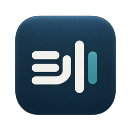

<p align="center">
  
</p>

<h1 align="center">Saywing</h1>

<p align="center">
  <b>Read aloud & dictate on your Mac.</b><br>
  Hear text. Write with your voice.
</p>

<p align="center">
  <a href="https://github.com/ChrBoebel/saywing/actions/workflows/ci.yml"></a>
  <a href="LICENSE"></a>
  
  <a href="docs/privacy.md"></a>
</p>

<!--
  Hero GIF goes here once recorded: Option-R, drag over a paragraph, the capsule reads it aloud, Escape stops.
  <p align="center"></p>
-->

Saywing is an open-source menu bar app for macOS. Press a shortcut, drag over any text on your screen, and hear it read aloud by a local neural voice. Or hold Fn, speak English or German, and let go: the text appears in the field you are typing in.

- **Hear text you can see.** Drag over a PDF, a slide, a chat or a paused video. Saywing recognizes the text on your Mac and reads it aloud.
- **Write with your voice.** Hold Fn, speak, release. Whisper Turbo ships with the app, so dictation works offline from the start.
- **Nothing leaves your Mac.** Text recognition, speech and dictation run locally. No account, no telemetry, no history.
- **Stop means stop.** Escape ends everything at once: the current sentence, the queue and any prepared audio.
- **Open and auditable.** Saywing makes only two kinds of network request: update checks you can turn off, and model downloads you confirm.

> Saywing is not a screen reader like VoiceOver and does not replace it. It reads regions you select; it does not navigate interfaces or announce controls.

## Install

Download the signed and notarized **beta** for your Mac (macOS 14 or later):

- **[Apple Silicon](https://www.christopherboebel.com/downloads/saywing/latest.dmg)** · **[Intel](https://www.christopherboebel.com/downloads/saywing/x86_64/latest.dmg)** · [download page with checksums](https://www.christopherboebel.com/en/saywing)

Open the DMG and drag Saywing to Applications. On first use, setup explains each permission before asking for it and asks you to accept the Supertonic 3 model terms before the reading voice is used. Saywing updates itself through Sparkle; you can turn automatic checks off in Settings.

It is a beta: Intel builds are tested under Rosetta only, and a fresh-Mac walkthrough is still open (see the status below). Watch [Releases](https://github.com/ChrBoebel/saywing/releases) (Watch → Custom → Releases) to hear about new versions, or [build from source](#building-from-source).

<details>
<summary><b>Status: beta, with known test gaps</b></summary>

Saywing is young software with known gaps:

- The development target is Apple Silicon. Intel (x86_64) builds exist, but they have only been tested under Rosetta, not on physical Intel hardware.
- macOS 14 is the minimum deployment target. Physical testing on macOS 14 and 15 is still incomplete; most testing happened on macOS 26.
- A fresh-Mac permission walkthrough, a full matrix of target apps for dictation, and a live VoiceOver/keyboard review are still open.
- A real MLX transcription with the rebuilt dictation runtime has not been run yet (see [runtime build](docs/runtime-build.md#verification-2026-10-23)).

See the [roadmap](docs/roadmap.md) for open gates and [CHANGELOG.md](CHANGELOG.md) for notable changes.

</details>

## Read aloud

1. Press **⌥R** (configurable) on any display.
2. Drag over the text you want to hear. A single click reads only the paragraph under the pointer.
3. Listen. Press **Escape** to stop.

- Text is recognized locally with Apple Vision (English and German) and spoken with the local [Supertonic 3](https://huggingface.co/Supertone/supertonic-3) voice. There is no cloud or system-voice fallback.
- Press the shortcut again while Saywing is speaking to queue another region, up to five texts.
- A small floating capsule offers Stop, Pause/Resume, speed from 0.75× to 2× and the queue. You can dock it at the bottom, left or right edge of the screen.

<details>
<summary>Selection tips</summary>

The selection works like ⌘⇧4: hold Space to move the region, Shift to lock an edge, and Option to grow it around the starting point.

</details>

## Dictate

1. Hold **Fn** and speak English or German.
2. Release Fn. The text is inserted where you are typing.
3. Press **Escape** to discard instead.

- For longer dictation, double-tap Fn or press **Fn + Space** to record hands-free. On keyboards without Fn, **⌥⇧Space** starts and stops recording.
- Speech is recognized locally with **Whisper large-v3-turbo**, which ships with the app. On Apple Silicon you can install **Qwen3-ASR 0.6B** or **Whisper Large v3** in Settings, only after you confirm the download. An optional local vocabulary helps with names and terms.
- Text is inserted with a short clipboard paste. Saywing restores your previous clipboard after 1 s (2 s optional), but only if nothing else has been copied in the meantime. Saywing never pastes into a target that changed during recognition.

## Also included

- **Meeting transcript (macOS 26 or later).** An explicitly started, consented live transcript of **Me** (microphone) and **Others** (other apps' audio). It uses Apple's on-device speech recognition. No audio is saved, and the transcript leaves memory only through Copy or Save. See [ADR 0006](docs/decisions/0006-local-meeting-transcript.md).
- **Guided setup** that explains each macOS permission before requesting it, followed by a real reading test.
- **English and German interface**, following your macOS language.
- **Accessibility:** VoiceOver labels and actions; respects Reduce Motion, Reduce Transparency and Increase Contrast.
- **Signed in-app updates** via [Sparkle](https://sparkle-project.org). Automatic update checks can be turned off.

## Privacy

Saywing handles potentially sensitive screen content and speech, so privacy is treated as a testable requirement. The details are in [docs/privacy.md](docs/privacy.md). In short:

- **Local processing.** OCR, speech synthesis, dictation and meeting transcription run on your Mac. There is no cloud OCR, TTS or ASR, no account, and no telemetry.
- **No history.** Screenshots, recognized text, dictated text and audio stay in memory for the active operation only. Nothing is written to disk unless you explicitly save a meeting transcript.
- **Clipboard.** Reading never writes to the clipboard. Dictation uses it briefly to paste, as described above.
- **Network.** The app makes exactly two kinds of network requests:
  1. **Sparkle update checks.** These are transparent and can be disabled, and an update is installed only after you confirm it. Updates are signed and no content is uploaded.
  2. **Model downloads you confirm.** Optional dictation models are fetched from pinned Hugging Face revisions, and every file is SHA-256-verified against a manifest bundled with the app before use.

  There is no other runtime network access. The speech and dictation workers run under a macOS sandbox profile that denies network access and file writes.
- **Permissions.** Each permission is requested only when you start the feature that needs it:
  - Screen Recording (reading)
  - Input Monitoring (Escape while another app is active)
  - Microphone and Accessibility (dictation and paste)
  - System audio recording (meeting transcript)

## Requirements

- macOS 14 Sonoma or later. The meeting transcript requires macOS 26.
- Apple Silicon is recommended. Intel builds use whisper.cpp for dictation and offer only the bundled Whisper Turbo model.

## FAQ

**How is this different from macOS Speak Selection?**
Speak Selection is built into macOS and reads text you can select, using the system voices. Saywing reads text you can see: it captures the region you drag, recognizes the text locally with Apple Vision, and speaks it with the Supertonic 3 neural voice. That also covers text you cannot select, such as text in images, scanned PDFs or video frames. Saywing recognizes English and German only. If your text is selectable and a system voice suits you, Speak Selection needs no extra app.

**Is Saywing a screen reader?**
No. Despite the project's former name, Saywing does not navigate interfaces, announce controls or provide non-visual operation of macOS. Use VoiceOver for that.

**Does it work offline?**
Yes. Reading aloud and dictation with the bundled models run without a network connection. The network is used only for update checks and for model downloads you confirm.

**Which models does Saywing use?**
Supertonic 3 for speech, and Whisper large-v3-turbo for dictation. Qwen3-ASR 0.6B and Whisper Large v3 are optional downloads on Apple Silicon. The licenses are listed [below](#license).

**Why do some files still say OpenScreenReader?**
Saywing was previously called OpenScreenReader. The repository was renamed from `ChrBoebel/OpenScreenReader`, and old links redirect. The Xcode project and scheme, Swift modules and bundle identifier keep the old technical name so existing settings stay compatible. Release builds keep their data in `~/Library/Application Support/Saywing`; only the local development runtime still uses `~/Library/Application Support/OpenScreenReader`.

## Building from source

### Build and test the app

Requirements for development:

- Xcode 26 with the macOS 26 SDK. CI runs on GitHub's `macos-26` image. The Swift package uses swift-tools-version 6.2.
- Python 3.11 or later to run the Python tests and scripts. The bundled runtimes themselves use CPython 3.12.
- Ruby, which ships with macOS, for some development scripts.

```sh
git clone https://github.com/ChrBoebel/saywing.git
cd saywing

# Core package tests
swift test

# App unit and UI tests (keep DerivedData outside ~/Documents; see CONTRIBUTING.md)
xcodebuild test -project OpenScreenReader.xcodeproj -scheme OpenScreenReader \
  -destination 'platform=macOS' -derivedDataPath /tmp/saywing-dd

# Release build without signing
xcodebuild build -project OpenScreenReader.xcodeproj -scheme OpenScreenReader \
  -configuration Release -destination 'platform=macOS' \
  -derivedDataPath /tmp/saywing-dd CODE_SIGNING_ALLOWED=NO
```

This produces a working `Saywing.app` with the menu bar, setup, region selection and OCR. **Model weights and the Python runtimes are not part of the Git repository.** Without them, the app reports that the speech or dictation runtime is unavailable instead of falling back to another voice.

### Speech and dictation runtimes

The runtimes are assembled from pinned, hash-verified public inputs:

- The **Supertonic 3 model** and its inference helper are pinned with per-file hashes and licenses in [`docs/research/supertonic-comparison-manifest.json`](docs/research/supertonic-comparison-manifest.json).
- The **dictation models** are pinned in [`Runtime/Dictation/`](Runtime/Dictation) (`*-manifest.json`).
- **Python environments** (CPython 3.12.15 from python-build-standalone, plus exact wheels) are locked in [`Runtime/Portable/`](Runtime/Portable/README.md) and the per-runtime `requirements-lock*.txt` files.

`scripts/assemble-release-runtime.py` downloads every input, verifies its size and SHA-256, builds both worker runtimes and assembles the complete runtime resources of a new `Saywing.app` in one command per architecture. Expect about 2 GB of downloads per architecture. Commands, pins and checks are in [docs/runtime-build.md](docs/runtime-build.md); development packaging is in [docs/development-packaging.md](docs/development-packaging.md).

For a local development speech runtime, `scripts/install-supertonic-runtime.rb` installs one under `~/Library/Application Support/OpenScreenReader`. None of these scripts runs inside the app, and none is invoked automatically.

## Documentation

- [Privacy](docs/privacy.md)
- [Roadmap](docs/roadmap.md)
- [Architecture](docs/architecture.md)
- [Architecture decision records](docs/decisions/README.md)
- [Release and updates](docs/release-and-updates.md)
- [Contributing](CONTRIBUTING.md)
- [Getting help](SUPPORT.md)
- [Security policy](SECURITY.md)
- [All documentation](docs/README.md)

## License

- **Source code:** Apache License 2.0. See [LICENSE](LICENSE) and [NOTICE](NOTICE).
- **Bundled models have their own licenses:**
  - **Supertonic 3** (speech model and voices) is licensed under the **BigScience OpenRAIL-M** license, which includes use restrictions. See [docs/licenses/SUPERTONIC-MODEL-TERMS.md](docs/licenses/SUPERTONIC-MODEL-TERMS.md).
    Saywing asks you to accept these model terms before the read-aloud voice is used. Speech you share must be marked as machine-generated, and anyone who passes a Saywing build on must pass the terms and the license on with it.
  - **Whisper** (OpenAI Whisper large-v3-turbo and large-v3) is licensed under MIT.
  - **Qwen3-ASR** is licensed under Apache-2.0.
- Third-party code, runtimes and libraries keep their own licenses. Their notices are collected in [docs/licenses/](docs/licenses).
